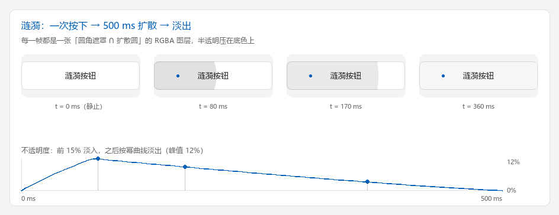

# 涟漪按钮：一个完整的自定义控件

这一页把 [自定义组件](custom-widget.md) 里的零件拼成一个**真的能动**的控件：
Material 风格的圆角按钮，按下时光标处扩散出一圈涟漪，键盘可触发、可禁用、可换主题。

完整代码在仓库的 `examples/ripple_button.py`（单文件，约 650 行，含自检）。
它演示四件事：

* 用绘制引擎画按钮底色，用 Pillow 合成**半透明图层**（Tk 的 canvas item 做不到逐像素透明）；
* 用 `after(16, ...)` 跑一段**按时间算进度**的动画，掉帧也不会拖长时长；
* 把 `DDrawWidget` 的状态位接到涟漪上（悬停 / 按压 / 焦点 / 禁用）；
* 换主题只需要换一份配色字典再重画。

<figure markdown>
  
  <figcaption>四帧由示例自己的 <code>ripple_layer()</code> 合成：底色走绘制引擎，涟漪是「圆角遮罩 ∩ 扩散圆」的 RGBA 图层。蓝点是按下位置，曲线是同一份 <code>ripple_alpha()</code></figcaption>
</figure>

## 跑起来

```bash
python examples/ripple_button.py                      # 默认自动挑栅格引擎（skia > cairo > pillow）
python examples/ripple_button.py --engine tksvg       # 指定引擎，观察每帧重绘的开销差异
python examples/ripple_button.py --theme dark         # 深色主题
python examples/ripple_button.py --check              # 只跑自检，不开窗口
```

| 参数 | 作用 |
| --- | --- |
| `--engine NAME` | 用哪个绘制引擎（`tksvg` / `wand` / `skia` / `pillow` / `cairo`） |
| `--theme {light,dark}` | 初始主题；窗口里按 `T` 也能切 |
| `--check` | 非交互自检：涟漪几何 + 控件生命周期，退出码 `0` 表示全过 |

按 `空格` 或 `回车` 也能从按钮中心触发一次涟漪（需要按钮先拿到焦点，点一下即可）。

## 为什么不用 `create_oval`

Material 的涟漪是一圈**半透明**的圆，压在按钮底色上，还要被**圆角**裁掉。
Tk 的 canvas item 没有逐像素 alpha：

* 给 item 设 `-alpha` 是**整块位图**的透明度，不是渐变的圆；
* `-stipple` 能给网点状的半透明，但没有抗锯齿，也没法逐帧变化浓度；
* `create_oval` 画出来的是**不透明**圆，会盖住底色和描边。

所以这里让 Pillow 先算出一张与按钮等大的 RGBA 图层，再用 `create_image` 贴上去——
透明度、圆角裁剪、抗锯齿就都对上了。

## 四步拆解

### 1. 遮罩：圆 ∩ 圆角矩形

```python
scale = SUPERSAMPLE                     # 3 倍超采样，缩小后边缘才不毛刺
size = (width * scale, height * scale)

clip = Image.new("L", size, 0)          # 圆角矩形：涟漪不能漫出圆角
ImageDraw.Draw(clip).rounded_rectangle(
    (0, 0, size[0] - 1, size[1] - 1), radius=radius * scale, fill=255
)

r = ripple_radius(width, height, x, y) * ease_out_cubic(progress) * scale
circle = Image.new("L", size, 0)        # 当前半径的实心圆
ImageDraw.Draw(circle).ellipse(
    (x * scale - r, y * scale - r, x * scale + r, y * scale + r), fill=255
)

# 逐像素取较小值 = 求交；再缩小到按钮尺寸，顺便得到抗锯齿
mask = ImageChops.darker(clip, circle).resize((width, height), Image.LANCZOS)
mask = mask.point(lambda value: int(value * opacity))

layer = Image.new("RGBA", (width, height), color)
layer.putalpha(mask)
```

`ripple_radius()` 取的是**按下点到最远角**的距离——涟漪扩到这么大才算盖满按钮，
否则从角落按下时涟漪会在按钮中间就停住。

### 2. 曲线：缓动 + 淡出

```python
def ease_out_cubic(progress):
    progress = min(1.0, max(0.0, progress))
    return 1.0 - (1.0 - progress) ** 3      # 起步快、收尾慢

def ripple_alpha(progress, peak=0.12):
    if progress <= 0.0 or progress >= 1.0:
        return 0.0
    fade_in = min(1.0, progress / 0.15)
    fade_out = max(0.0, 1.0 - (progress - 0.15) / 0.85) ** 1.2
    return peak * fade_in * fade_out
```

半径走缓动曲线（`ease_out_cubic`），浓度走"前 15% 淡入、之后淡出"的幂曲线。
两条曲线分开，视觉上才像 Material：先是**一团浓色迅速铺开**，再**整体慢慢褪掉**。

### 3. 动画循环：16 ms 一帧，进度按时间算

```python
def _tick(self):
    self._job = None
    if not self.winfo_exists() or self._ripple is None:
        return
    if self._ripple.progress() >= 1.0:
        self._ripple = None
        self._paint()                       # 最后一帧擦掉叠加层
        return
    self._paint()
    self._schedule()                        # 再来一帧

def _schedule(self):
    if self._job is None and self._ripple is not None:
        self._job = self.after(FRAME_MS, self._tick)
```

进度不是"每帧 +16 ms"累加出来的，而是每帧用 `time.monotonic()` 重新算：

```python
@dataclass
class _Ripple:
    x: float
    y: float
    started: float

    def progress(self):
        elapsed_ms = (time.monotonic() - self.started) * 1000.0
        return min(1.0, max(0.0, elapsed_ms / RIPPLE_MS))
```

这样**掉帧只丢帧、不拖时长**：主线程卡一下，下一帧直接跳到正确的进度。
把 `started` 参数留给外部传，是给自检和截图用的——一行就能复现"播到 40%"的那一帧。

`self.after(...)` 挂在控件自己身上，取消也用控件自己的 `after_cancel`；
**不要对 `root` 调 `after_cancel`**（见 [常见问题与排查](faq.md) 第 5 条）。

### 4. 叠放顺序与图片保活

```python
def _paint(self):
    width, height = self.winfo_width(), self.winfo_height()
    if width <= 1 or height <= 1:
        return

    palette = self.palette
    state = self.interaction_state(self.dcget("enabled", True))
    radius = float(min(self.dcget("corner_radius", 8), width / 2.0, height / 2.0))

    self.delete("all")

    # 1) 底色 + 1px 描边：交给绘制引擎
    body = self.draw_roundrect(
        0, 0, width, height, radius,
        fill=palette["disabled"] if state == "disabled" else palette[state],
        outline=palette["outline"],
        outline_opacity=palette["outline_opacity"],
        width=1, temppath=self.temppath,
    )
    self.addtag_withtag("body", body)

    # 2) 涟漪：压在底色之上、文字之下
    if self._ripple is not None and state != "disabled":
        self._draw_ripple(width, height, radius)

    # 3) 文字
    self.create_text(
        width / 2.0, height / 2.0,
        text=self.dcget("text", ""), fill=text_color, font=self.font,
        tags=("text",),
    )

    # 4) 焦点环画在最上层，向内缩 3px
    if self.isfocus and state != "disabled":
        ring = self.draw_roundrect(
            3, 3, width - 3, height - 3, max(radius - 3.0, 1.0),
            fill="transparent", outline=palette["focus"], width=2,
            temppath=self.temppath2,
        )
        self.addtag_withtag("focus", ring)
```

每帧 `delete("all")` 再全部重画，看起来"很浪费"，但实测完全够（见下面的性能表）。
换成增量重绘反而要维护四层 item 的相对顺序，得不偿失。

涟漪图层每帧都是新的 `PhotoImage`，**必须交给 `_keep_photo()` 保活**，
否则 Python 侧一回收，画布上的图就变白板：

```python
photo = ImageTk.PhotoImage(layer, master=self)
item = self.create_image(0, 0, anchor="nw", image=photo, tags=("ripple",))
self._keep_photo(item, photo)      # 少了这一行，涟漪跑几帧就消失
```

## 事件与状态

`DDrawWidget` 已经维护好 `enter` / `button1` / `isfocus` 三个状态位，
并把 `<Button-1>` 绑给了 `_event_on_button1`。覆写时先调 `super()`，
再补自己的逻辑——**圆心直接用 `event.x` / `event.y`**，这是控件坐标，
和 `create_image` 的坐标系一致，不需要换算：

```python
def _event_on_button1(self, event=None):
    super()._event_on_button1(event)
    if not self.dcget("enabled", True):
        return
    self.focus_set()
    x = event.x if event is not None else self.winfo_width() / 2.0
    y = event.y if event is not None else self.winfo_height() / 2.0
    self.ripple(x, y)
```

键盘触发单独绑：`<space>` / `<Return>` 从中心起涟漪并发一次 `<<Clicked>>`，
和 `tk.Button` 的行为对齐。

换主题就是换字典再重画，不需要重建控件：

```python
button.dconfigure(theme="dark")     # 本控件覆写了 dconfigure，改完立即 _draw()
```

## 三个真实踩过的坑

### 坑 1：基类顺序写错会直接崩

```python
class RippleButton(DCanvas, DDrawWidget): ...
# TypeError: Cannot create a consistent method resolution order (MRO)
#            for bases DCanvas, DDrawWidget
```

`DDrawWidget` 本身就继承自 `DCanvas`（中间还隔着 `DDrawWidgetCanvas`）,
所以只需要 `class RippleButton(DDrawWidget)`。基类一多，MRO 立刻罢工。

### 坑 2：`draw_roundrect()` 不接受 `tags`

```python
item = self.draw_roundrect(..., tags=("body",))
# ValueError: Invalid attribute 'tags' for svg-element <rect>.
```

`draw_roundrect()` 的额外关键字参数最终会交给 svgwrite 的 `rect(**kwargs)`，
而 `tags` 不是合法 SVG 属性——**只有走 SVG 回退路径时才会暴露**，
在栅格引擎上测不出来。打标签请用返回值：

```python
item = self.draw_roundrect(...)
self.addtag_withtag("body", item)
```

### 坑 3：第一帧是空的，直到鼠标划过

**症状**：窗口起来了，按钮位置一片空白；鼠标移上去才出现。

**原因**：`DDrawWidget._draw()` 里有一句 `if not self.winfo_ismapped(): return`。
"先把控件 `pack()` 好、再 `mainloop()`"的写法中，`<Configure>` 往往在窗口
**映射之前**就发完了（那时 `winfo_width()` 还是 `1`），映射之后再也不会来一次——
于是控件永远停在"没画"的状态。

**怎么办**：补一个 `<Map>` 绑定，映射发生时再画一次：

```python
self.bind("<Map>", self._event_map, add="+")

def _event_map(self, event=None):
    self._draw(event)
```

这个问题只影响"先建 UI 再进事件循环"的写法；如果你在已经显示的窗口里
动态创建控件，`<Configure>` 会正常到来，看不出异常。写自己的控件时建议直接照抄这段。

## 性能

每帧都是**全量重绘**（`delete("all")` + 重新渲染底色 + 合成涟漪图层），
在一台普通开发机上测一个 200×48 的按钮、40 帧的耗时：

| 引擎 | 中位数 | p95 |
| --- | --- | --- |
| `skia` | 0.42 ms | 0.90 ms |
| `pillow` | 0.38 ms | 0.79 ms |
| `cairo` | 0.41 ms | 0.64 ms |
| `tksvg` | 4.66 ms | 6.43 ms |
| `wand` | 5.35 ms | 7.41 ms |

60 fps 的预算是每帧 16.7 ms，所以哪怕走默认的 SVG 引擎（`tksvg`）也还有两倍余量；
换成栅格引擎后开销低一个数量级，涟漪之外的动画也可以照这个模式做。
测量方式是包住 `_paint()` + `update_idletasks()` 循环 40 次，取中位数与 p95。

!!! tip "想再快一点"
    真正贵的是每帧重新渲染底色。把底色渲一次缓存成 `PhotoImage`，
    只在尺寸 / 主题 / 状态变化时重建，涟漪帧就只剩"合成 + 贴图"。
    示例里没这么做，是因为它想演示"最直白的写法够不够用"——答案在这个尺寸下是够的。

## 换成你自己的控件

把这个示例搬到你自己的控件上，只需要替换四件事：

1. **底色**——`draw_roundrect` 换成你的绘制调用（`draw_track` / `draw_thumb` / 自定义后端）；
2. **涟漪形状**——`ripple_layer()` 里的圆角矩形遮罩换成你控件的轮廓；
3. **触发点**——`ripple(event.x, event.y)` 换成长按、滚动、状态切换都能算出的中心；
4. **配色**——`THEMES` 换成你自己的字典，`dconfigure(theme=...)` 保持同一个入口。

动画循环那一套（`monotonic` 算进度 + `after` 调度 + 结束时擦干净）可以原样复用。

## 下一步

* [自定义组件](custom-widget.md) —— `DObject` / `DCanvas` / `DDrawWidget` 的完整接口
* [绘制引擎](custom-drawing.md) —— 换引擎、写引擎、缓存与像素预算
* [回归与性能](benchmarks.md) —— 把示例里的自检接进 `run_all.py` 的方法
